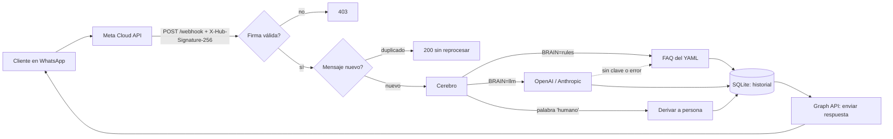

# whatsapp-ai-assistant

[](https://github.com/Laxionx/whatsapp-ai-assistant/actions/workflows/ci.yml)

> A FastAPI webhook for the WhatsApp Cloud API with signature validation, idempotent processing and a swappable brain (FAQ rules or an optional LLM).
> Runs locally with no real credentials thanks to a signed-webhook simulator.

Asistente de WhatsApp para pequeños negocios. Recibe mensajes por el webhook oficial de Meta, responde con reglas/FAQ definidas en un YAML o con un LLM (OpenAI o Anthropic) y deriva a una persona cuando el cliente lo pide. Guarda el historial en SQLite y expone un endpoint de administración protegido.

## Flujo



## Estructura

```
app/
  main.py        rutas: GET/POST /webhook, /admin/*, /health
  security.py    firma HMAC-SHA256 y comparación en tiempo constante
  whatsapp.py    parseo del payload y envío por la Graph API
  service.py     flujo de un mensaje (idempotencia -> cerebro -> respuesta)
  brain/         rules.py (FAQ), llm.py (OpenAI/Anthropic), derivación a humano
  db.py          SQLite: historial, idempotencia, estado de derivación
config/negocio.yaml   datos del negocio (ejemplo: panadería ficticia)
scripts/simular_mensaje.py   webhook falso firmado para pruebas locales
tests/           pytest, sin red ni credenciales (cobertura del 100 %)
```

## Correrlo en local (sin cuenta de Meta)

```bash
python -m venv .venv && source .venv/bin/activate   # en Windows: .venv\Scripts\activate
pip install -r requirements-dev.txt
cp .env.example .env            # los valores dev-* son solo para local

uvicorn app.main:app_factory --factory --port 8000
```

En otra terminal, el simulador envía un webhook firmado igual que Meta y muestra la respuesta del bot:

```bash
python scripts/simular_mensaje.py "¿A qué hora abren?"
# Webhook -> HTTP 200 {"status":"ok","messages":1}
# Bot:     Atendemos de lunes a sábado de 6:00 a 20:00 y domingos de 7:00 a 14:00.
```

Sin `WHATSAPP_ACCESS_TOKEN` el bot no llama a Meta: solo registra la respuesta en el historial. Para verla:
(`ADMIN_TOKEN` es el del `.env`; en el ejemplo, `dev-admin-token`.)

```bash
curl -H "Authorization: Bearer $ADMIN_TOKEN" http://127.0.0.1:8000/admin/conversations
```

Tests y lint:

```bash
ruff check . && ruff format --check .
pytest          # cobertura en la terminal; CI exige >= 90 %
```

Con Docker: `docker compose up --build` (lee el `.env`).

## Conectarlo a una cuenta real de Meta

1. Crea una app de tipo *Business* en [developers.facebook.com](https://developers.facebook.com) y añade el producto **WhatsApp**.
2. En *WhatsApp > API Setup* copia el **Phone number ID** y genera un **token de acceso** (para producción, un token permanente de *System User*).
3. En *App settings > Basic* copia el **App Secret**.
4. Rellena el `.env` con tus valores: `WHATSAPP_ACCESS_TOKEN`, `WHATSAPP_PHONE_NUMBER_ID`, `WHATSAPP_APP_SECRET`, y un `WHATSAPP_VERIFY_TOKEN` e `ADMIN_TOKEN` largos y aleatorios.
5. Expón tu servidor con HTTPS (un despliegue o un túnel como `cloudflared`/`ngrok` en desarrollo).
6. En *WhatsApp > Configuration* registra `https://TU-DOMINIO/webhook` con tu verify token y suscríbete al campo **messages**.
7. Envía un mensaje al número de prueba desde tu WhatsApp.

`GRAPH_API_VERSION` es configurable (por defecto `v23.0`); revisa en el [changelog de Graph API](https://developers.facebook.com/docs/graph-api/changelog) cuál es la vigente y actualízala cuando quieras.

### Activar el LLM (opcional)

```env
BRAIN=llm
LLM_PROVIDER=anthropic        # o openai
ANTHROPIC_API_KEY=...         # u OPENAI_API_KEY
```

El prompt del sistema se construye con `config/negocio.yaml`. Si falta la clave o el proveedor falla (red, HTTP, respuesta vacía), el bot responde con las reglas.

## Decisiones de seguridad

- **Firma**: cada POST se valida con `X-Hub-Signature-256` (HMAC-SHA256 del cuerpo crudo con el App Secret) usando `hmac.compare_digest`. Sin secreto configurado se rechaza todo.
- **Idempotencia**: Meta reintenta entregas. El `id` de cada mensaje se reclama con `INSERT OR IGNORE` en SQLite antes de procesar, así un duplicado nunca genera una segunda respuesta. Los eventos de estado (`statuses`) se ignoran.
- **Respuesta rápida**: el webhook contesta 200 de inmediato y el cerebro corre en segundo plano.
- **Secretos**: solo por variables de entorno (`SecretStr`, `.env` fuera de git). Los logs nunca incluyen tokens ni cabeceras, y los números de teléfono se enmascaran (`***0222`). Los errores del LLM registran solo el tipo de excepción.
- **Administración**: `/admin/*` exige `Authorization: Bearer <ADMIN_TOKEN>` con comparación en tiempo constante; si no hay token configurado, queda deshabilitado.
- **Contenedor**: la imagen corre con un usuario sin privilegios.

Límite conocido: el procesamiento en segundo plano vive en el mismo proceso; si cae justo después del 200, ese mensaje no se reintenta (compromiso aceptado para mantener el proyecto pequeño; para producción usaría una cola).

## Adaptarlo a otro negocio

Edita solo `config/negocio.yaml`; no hay que tocar código:

```yaml
nombre: "Mi Negocio"
descripcion: "Qué vende o hace, en una frase."
palabra_humano: "humano"          # palabra que deriva a una persona
faq:
  - claves: ["horario", "abren", "cierran"]
    respuesta: "Lunes a viernes de 9:00 a 18:00."
```

Cada entrada de `faq` tiene palabras clave (sin distinguir mayúsculas ni acentos) y una respuesta; gana la entrada con más coincidencias. Con `BRAIN=llm`, ese mismo contenido alimenta el prompt del modelo.

---

Construido con desarrollo asistido por IA (Claude Code), con revisión y pruebas propias.

Licencia MIT, 2026, Anthony Vera Baldeón.
